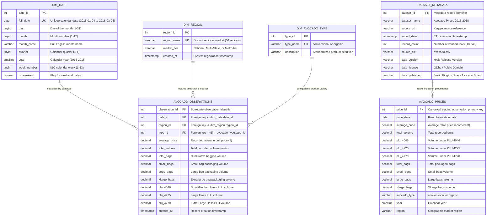

# Entity-Relationship (ER) Architecture Documentation
## Agricultural Market Pricing & Sales Dashboard
**Database:** `agricultural_market_db` (MySQL 8.x)

---

## 1. Conceptual Dimensional Model

The database is structured around a **Dimensional Star Schema in Third Normal Form (3NF)** for Online Analytical Processing (OLAP) and high-speed analytical aggregations, backed by a canonical staging table for initial raw ingestion:

---

## 2. Cardinality & Relationship Constraints

| Parent Table | Child Table | Relationship | Cardinality | Foreign Key | Cascade Rule |
| :--- | :--- | :--- | :--- | :--- | :--- |
| `dim_date` | `avocado_observations` | One-to-Many | 1 : N | `date_id` | `ON DELETE RESTRICT ON UPDATE CASCADE` |
| `dim_region` | `avocado_observations` | One-to-Many | 1 : N | `region_id` | `ON DELETE RESTRICT ON UPDATE CASCADE` |
| `dim_avocado_type` | `avocado_observations` | One-to-Many | 1 : N | `type_id` | `ON DELETE RESTRICT ON UPDATE CASCADE` |

### Constraint Validations:
- `chk_obs_price`: `average_price >= 0`
- `chk_obs_volume`: `total_volume >= 0`
- `dim_date.full_date`: `UNIQUE NOT NULL`
- `dim_region.region_name`: `UNIQUE NOT NULL`
- `dim_avocado_type.type_name`: `UNIQUE NOT NULL`
